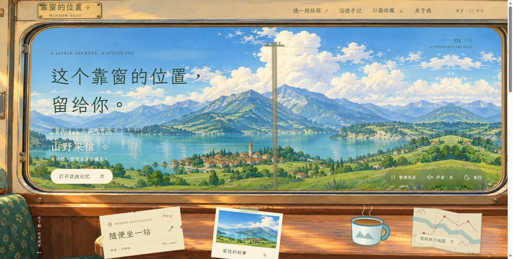

# 靠窗的位置 · WINDOW SEAT

从一扇列车窗口出发，收藏不同时间与风景里的旅行片段。



## 场景与设计

旅行内容往往被密集列表打断。这个项目用车窗场景和昼夜变化组织浏览，让风景与目的地收藏形成连贯体验。

这是个人产品实践与 Vibe Coding 作品，代码实现有 AI 辅助。仓库提供可运行实现与测试，便于查看产品流程、交互取舍及实现边界。

## 核心功能

- 三组车窗场景及昼夜过渡，按场景探索内容。
- 收藏喜欢的目的地，状态保存在当前浏览器。
- 可选合成列车声音、键盘操作与减少动态效果支持。
- 桌面与移动端响应式布局。

## 本地运行

需要 Node.js 22 或更新版本。在仓库根目录执行（网页运行无需安装 npm 依赖）：

```sh
node scripts/serve.mjs --port 4180
```

浏览器打开 http://127.0.0.1:4180 。

## 验证

```sh
node --test tests/*.test.mjs
```

`tests/` 中若有浏览器检查脚本，需要额外安装 Playwright 及脚本指定的浏览器，并先启动本地服务；它们不属于上述无依赖测试。

## 实现与边界

技术：JavaScript / CSS / Web Audio / Node.js。`dist/` 包含可直接运行的网页源码和静态资源，`tests/` 包含回归检查。

目的地与旅行文案是示例内容，不提供实时行程、订票或真实用户旅行记录。收藏仅保存在当前浏览器。

仓库不包含个人记录、上传的私人文件、账户凭据或本地开发缓存。

## 素材与许可

场景使用 AI 辅助生成图像；LXGW WenKai TC 字体子集及 SIL OFL 许可位于 `dist/assets/FONT-LICENSE.txt`。

第三方内容依照各自许可证使用；本仓库未额外授予其余原创代码与素材的开源许可。
